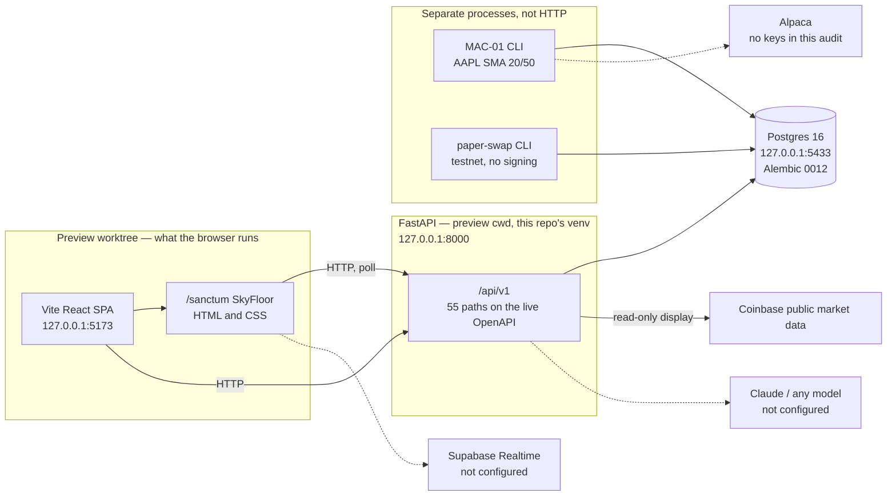

# Architecture

Date: 13 November 2026. This is the architecture that is actually running and checked in, not a target. Delivery wishes live in `docs/architecture/target-state.md` and in `docs/MASTER_BUILD_PLAN.md`. Status of each plan task is `docs/IMPLEMENTATION_STATUS.md`.

This file is the document requested as `docs/ARCHITECTURE.md`. On this Mac the volume is case-insensitive, so `docs/ARCHITECTURE.md` and `docs/architecture.md` are one file. The short pointer that used to be the whole of this file is now the section "Older notes".

Confidence: high for the trees, the live HTTP checks, and the files named below. Medium for pixels that were not opened in a browser this pass. Low for any intent that is not written in the repo.

## One repository, two working trees

There is one git repository. The preview directory is a linked worktree, not a second project and not a fork. `git` common dir for both is `/Users/marcusbrown/Developer/veytrix/.git`. Remote `origin` is `https://origin.cursor.com/dekuworks/veytrix.git`. Nothing was pushed in this pass.

| Tree | Path | Branch | HEAD | What it is |
| --- | --- | --- | --- | --- |
| Main checkout | `/Users/marcusbrown/Developer/veytrix` | `feature/phase-0-reconnaissance` | `21aab82` | Phase 0 reconnaissance plus this audit. Sanctum here is the Phaser floor. This code rejects registry `status = enabled`. |
| Live Sanctum | `/Users/marcusbrown/Developer/veytrix-sanctum-preview` | `feature/agent-communication` | `86e9d7d`, plus uncommitted work | The sky view the browser is serving. Vite cwd is `apps/web` in this tree. The API process cwd is this tree. |

`feature/phase-0-reconnaissance` has 2 commits that are not on `feature/agent-communication` (`8b581bc`, `21aab82`). `feature/agent-communication` has 5 commits that are not on the Phase 0 branch (`f9b0824`, `8a59ee2`, `2bc3b04`, `d04b5e2`, `86e9d7d`). They share history through `5ef96c6`.

The live sky view is canonical for what you see at `http://127.0.0.1:5173`. This checkout is canonical for the Phase 0 docs committed here. Neither tree contains the other tree's unique commits. The preview's uncommitted files were not copied and not discarded.

Pros of leaving the split in place: the running UI stays up, and this audit cannot overwrite Roads, Dayvid, the speech bubbles, or the registry notes. Cons: a test on this branch reads the live database and fails, and a reader of only one tree will get the wrong picture of Sanctum. Confidence: high.

## What is listening

Checked 13 November 2026 with read-only requests. No process was restarted.

| Process | Bind | Cwd | Result |
| --- | --- | --- | --- |
| Vite | `127.0.0.1:5173` | preview `apps/web` | HTTP 200 |
| uvicorn (`veytrix/.venv`) | `127.0.0.1:8000` | preview tree | `GET /api/v1/health` 200, `GET /api/v1/ready` 200, database up |
| Postgres 16 container `veytrix-local-postgres` | `127.0.0.1:5433` | Docker | Alembic `0012_enable_registry_status` |

`docker-compose.yml` in git publishes Postgres on `127.0.0.1:5432`. That is not the database in use. Port 5432 is `daypilot-db`. Do not point Veytrix at it.

Diagnostics from the running API: `env` `local`, `trading_mode` `paper`, `live_broker` `disabled`, `auth` `not_configured`, `execution_permitted` false, `csrf` `not_implemented`, `rate_limit` `process_local`. Python 3.14.6. API package version 0.1.0.

## Current shape

No arrow from the browser, the chat routes, or the inference router reaches `Mac01Engine.run`, an Alpaca order, or `veytrix_ai` signing. `GET /api/v1/system/submission` on the live API reported `live_submission_possible` false, `api_reaches_engine` false, `broker_called` false, and `order_route` `absent`. `GET /api/v1/comms/flags` reported `live_execution` false and `model` `not_configured`. `GET /api/v1/inference/posture` reported `paid_inference_enabled` false, `cursor_subscription_runs_agents` false, and `ollama_configured` false.

## Web

`apps/web` is a Vite + React 19 + TypeScript SPA. React Router. Tailwind 4. IBM Plex. TradingView Lightweight Charts 5.2.1 draws bars the API returns. Phaser 3.90 is still a dependency.

Two Sanctum implementations exist:

| | Main checkout | Preview worktree, and the running page |
| --- | --- | --- |
| Route | `/sanctum` | `/sanctum` |
| Renderer | Phaser, `apps/web/src/sanctum/game.ts` | `SkyFloor` in `apps/web/src/sanctum/ui/SkyFloor.tsx` |
| Technique | Canvas, 60 × 42 tiles, A* | HTML and CSS. Not React Three Fiber. Not Three.js. Neither package is in `package.json`. |
| Mounted by the page you have open | No | Yes. `SanctumPage.tsx` imports `SkyFloor`. `game.ts` is still in the tree and is not imported by that page. |

The preview sky view, including uncommitted edits, has: a scrollable Live Activity Feed (`.sx-feed` overflows), speech bubbles (`.thought.live.overlay`, animation about 5.4s), Roads and Dayvid paths that the unit test keeps off the boardroom table, a chat panel, and a north-wall sign that reads VEYTRIX SANCTUM. This pass did not open the page in a browser, so those are source facts, not a fresh screenshot.

Floors F2–F9 and B1 are not scenes. There is no elevator and no cutaway building. React Three Fiber is a later target written in `docs/MASTER_BUILD_PLAN.md`. It is not the current sky view.

## API

FastAPI under `services/api`. Boot refuses a truthy `VEYTRIX_ENABLE_LIVE_BROKER`, any `VEYTRIX_ENV` other than `local`, and a database host other than `127.0.0.1`, `localhost`, or `postgres`. There is no auth gateway.

The live OpenAPI document had 55 paths. Groups that exist today:

- Health, ready, diagnostics, system status, submission evidence.
- Market: synthetic SAMPLE bars, plus Coinbase display for BTC-USD, ETH-USD, and SOL-USD. This pass did not call Coinbase.
- Risk: `POST /api/v1/risk/size` and shield / reservation previews. They do not submit an order.
- MAC-01 ledger reads, pause, resume, and kill-switch engage. The API does not call the engine.
- Paper positions, research notes, source events, audit log, treasury projection and reminder dates.
- Paper-swap ledger reads. No swap submit route. The API does not import `veytrix_ai`.
- Agent registry and agency desk detail.
- Comms: conversations, messages, discussions, floor, feed, flags. Replies are labelled `tool_verified`, `scripted`, or `simulated`. The comms module is written so it does not emit `model_generated`.
- Inference posture and `POST /api/v1/inference/route`. That router chooses a refusal. It does not call Anthropic, OpenAI, Ollama, or Cursor.

`GET /api/v1/conversations/flags` is not a route. It returned 404. The flags route is `GET /api/v1/comms/flags`.

## Data

Local Postgres 16. Alembic head on the running database is `0012_enable_registry_status`. That revision file is untracked in the preview worktree (`services/api/alembic/versions/20261109_0012_enable_registry_status.py`). It is not on this branch. This branch's migrations stop at `0010_futures_desk`.

`0012` allows `status` of `disabled`, `paused`, or `enabled`, and the live rows are `enabled`. `can_submit_orders`, `can_sign`, `can_transfer_funds`, and `holds_credentials` were false on every row returned by the live `GET /api/v1/agents`. The running preview API accepts that. This branch's `AgentDesk.status` is `Literal["disabled", "paused"]`, so the same rows fail validation and `GET /api/v1/agents` returns 503. That is fail-closed on this branch. It is also why two tests fail. See `docs/reviews/phase-0-sanctum-baseline-2026-11-13.md`.

Schema `private` holds the registry. An earlier audit recorded RLS on those tables and recorded the API login as a superuser that bypasses RLS. This pass did not re-query role attributes. Authentication is not implemented. RLS is not an access-control system for the running API.

## Agents

Registry codes, from the live `GET /api/v1/agents`: `SUPERVISOR-01`, `DAY-01`, `STOCK-01`, `CRYPTO-01`, `DEFI-01`, `ETF-01`, `RESEARCH-01`, `RISK-01`, `TREASURY-01`, `FUTURES-01`. All `paper_only`, all `enabled`, none able to submit, sign, transfer, or hold credentials.

The preview UI and `services/api/veytrix_api/model_router.py` use these display names: Roads, Dayvid, Vex, Nyx, Cipher, Lyra, Astra, Aegis, Midas. `FUTURES-01` is "Futures" on the sky floor and is absent from the inference persona map. There is no YIELD identity. `docs/phase-0/agent-roster.md` on this branch still says Astra and Dayvid are not paired to codes. The preview has paired them. This audit does not change either pairing.

`GET /api/v1/futures/posture` is hardcoded: desk status `disabled`, Topstep automation `disabled`, account `not_connected`, orders `absent`, market data `not_read`. That posture does not read the registry row, which is why it can say disabled while the registry says enabled.

## Trading and money

- MAC-01 is an AAPL SMA 20/50 crossover in `services/quant`. The mission text says EMA 20/50. The code is SMA. Paper is the config default. No Alpaca key was set in the processes checked here. No paper order and no live order was sent this pass.
- alpaca-py is a dependency of the CLI. The API must not import it.
- The paper-swap CLI simulates testnet fills and cannot sign. `contracts/` is unaudited reference code and is not deployed.
- Treasury math can project a 50/50 split with a $2,000 cap. It does not pay anyone. There is no bank transfer.
- Roads cannot grant permissions. Aegis is a desk name and a deny-list, not an independent runtime that approves trades. Deterministic previews exist. They withhold release.

## What is not in this architecture

No Claude adapter, no model key, no Redis, no queue, no Supabase project, no AWS account, no staging app, no production app, no member portal, no RBAC, no floors F2–F9 or B1, no React Three Fiber scene, no DayPilot, no WhatsApp, no Quiver Quant, no Topstep session.

## Older notes

`docs/architecture/current-state.md` is the 8 November inventory. It is stale on commit history, Alembic head, and the sky view. `docs/architecture/target-state.md` is a target, not this system. `docs/phase-0/reconnaissance.md` describes the Phaser floor on this branch as of 9 November and does not describe the preview sky view.
