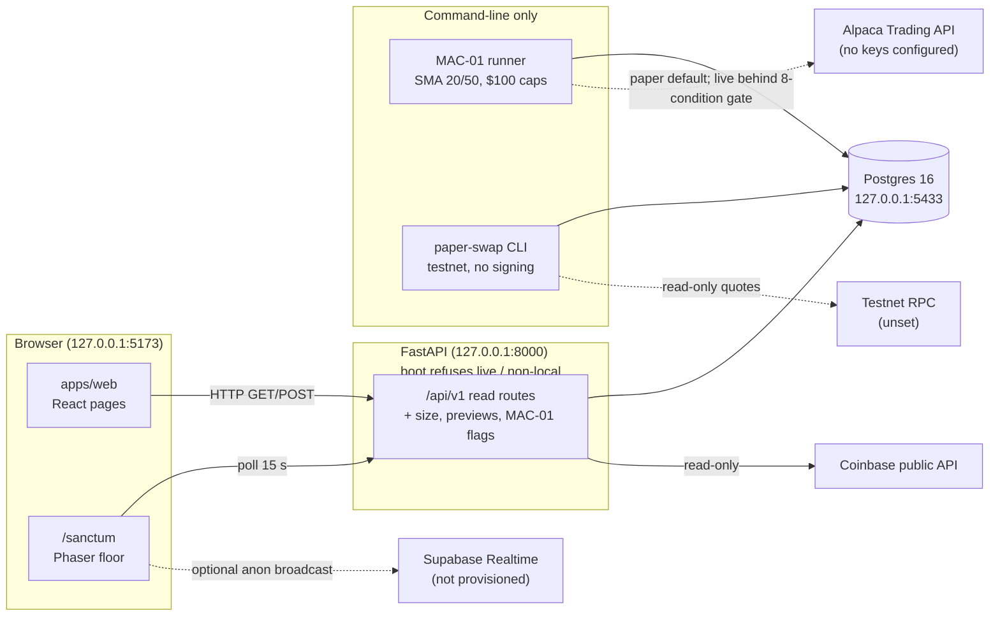

# Phase 0 reconnaissance

Source plan: `VEYTRIX_MASTER_CURSOR_TASKS.md` v1.0 (November 2026), read from the owner's Downloads folder. No copy exists in `docs/`, so the Downloads file is the working spec and is not copied in full here. Audit date: 9 November 2026. Branch `feature/phase-0-reconnaissance`, cut from `feature/sprint-0-foundation` at `5ef96c6`.

This complements `docs/architecture/current-state.md` (8 November, written against an older plan, v4.1) rather than replacing it. Where that file is now stale, this one says so. Companion files: `agent-roster.md` and `environment.md` in this folder.

Confidence: high for what was read in the tree and for the checks run below. Medium for runtime behaviour of Sanctum, because the browser was not opened in this pass. Low for anything about the owner's intent behind the master task file.

## 1. Plan numbering

The master task file numbers phases 0 to 12. The repository's existing checklist (`docs/implementation-checklist.md`, `docs/issue-board.md`) numbers a different plan, 00 to 13. They do not line up: for example, master Phase 7 (Alpaca paper) is spread across old phases 03 and 05, and master Phase 10 (Boardroom, DayPilot, WhatsApp) is old phase 10 plus new WhatsApp work. This document uses master numbering. The old checklist is left as is.

## 2. Repository inventory

| Area | What exists | Version (installed) |
| --- | --- | --- |
| Monorepo | One git repo. `apps/`, `services/`, `packages/shared`, `contracts/`, `infra/docker`, `config/`, `tests/`, `docs/`. 286 tracked files. Remote `origin` is `origin.cursor.com/dekuworks/veytrix`. | |
| Web | `apps/web`: Vite + React SPA, React Router, Tailwind, IBM Plex. 21 routes in the shell (plus a catch-all), and `/sanctum`, which `App.tsx` renders full-screen outside the shell. | React 19.3.1, Vite 8.3.6, TypeScript 7.0.2, React Router 7.18.5, Tailwind 4.3.5, Vitest 5.1.0 |
| Rendering engine (Sanctum) | Phaser 3, `Phaser.AUTO` (WebGL with Canvas fallback), `pixelArt`, `Scale.RESIZE`, audio off. Sprites are generated at runtime; no asset CDN. | Phaser 3.90.0 |
| Charts | TradingView Lightweight Charts (Apache-2.0 library, not the proprietary Charting Library). | 5.2.1 |
| API | `services/api`: FastAPI, SQLAlchemy, Alembic, psycopg. 41 paths, 44 operations in `packages/shared/openapi.json`. | FastAPI 0.162.2, SQLAlchemy 2.1.8, Alembic 1.20.1, Pydantic 2.14.3 |
| Database | Local Postgres 16 on `127.0.0.1:5433` (container `veytrix-local-postgres`). Alembic head `0010_futures_desk`. Schema `private` for the registry with RLS and append-only triggers. | Postgres 16 |
| Quant | `services/quant/veytrix_quant/mac01`: AAPL SMA 20/50 CLI bot, Alpaca adapter. | alpaca-py 0.45.0 |
| Risk | `services/risk`: Decimal sizing, shield and reservation previews, treasury projection. | |
| Market data | `services/market-data`: synthetic SAMPLE, Coinbase public candles and tickers, feed health. | |
| Simulated swaps | `services/ai-research/veytrix_ai`: testnet-only paper-swap CLI. No signing. | |
| Contracts | `contracts/`: Foundry, two unaudited swap helpers. Not built here (Foundry absent), not deployed. | |
| Placeholders | `services/execution`, `services/event-intelligence`, `services/portfolio`, `apps/gods-eye`: README only. | |
| Hosting / deployment | None. Loopback only. Docker Compose exists for local use. No Vercel, AWS, or Supabase project. | |
| Supabase usage | `@supabase/supabase-js` 2.119.0 is a web dependency. Sanctum subscribes to a `sanctum-status` broadcast channel only if `VITE_SUPABASE_URL` and an anon key are set. Neither is set. No migrations target Supabase. | |
| CI | `.github/workflows/ci.yml`: Ruff, pytest against Postgres 16, web typecheck/test/build, `npm audit`, secret scan. Actions use floating tags. CI has not been observed passing on the remote. | |

Stale in `current-state.md`: it says there are no commits and no remote (there are now commits and an `origin` remote), and it gives head `0009` (now `0010`). The rest still matches the tree.

## 3. Sanctum as it works today

Location: `apps/web/src/pages/SanctumPage.tsx` (page, 730 lines) and `apps/web/src/sanctum/` (`game.ts`, `floor.ts`, `pathfinding.ts`, `sprites.ts`, `activity.ts`, `realtime.ts`, `wednesday.ts`, `README.md`). Route `/sanctum` in the existing Vite app.

Everything in this section must be preserved by later phases.

| Behaviour | Where | How it works |
| --- | --- | --- |
| Floor | `floor.ts`, `sprites.ts` | 60 × 42 grid of 16 px tiles. Hall, two lounges, doors, Wednesday boardroom, globe, shelves, plants, lamps. One pre-rendered floor texture. |
| Avatars | `sprites.ts`, `game.ts` | Ten generated pixel sprites, one per registry code, each with its own hair, skin, shirt and accessory (crown on `SUPERVISOR-01`). Four poses (`sit`, `walk`, `work`, `talk`) × two frames, swapped every 280 ms. Label and status dot float above each avatar. |
| Desk positions | `floor.ts` `DESK_TILES` | Fixed tile per code. See `agent-roster.md`. |
| Pathfinding | `pathfinding.ts` | A* with Manhattan heuristic on `isWalkable` (interior, not furniture, doors open). |
| Movement | `game.ts` `walk`, `moveNpcs` | Avatars walk tile to tile at 78 px/s. Visitor walks at 110 px/s with arrows or WASD in Floor View, with wall collision. |
| Boardroom | `game.ts` `gather`, `returnToDesks`; `floor.ts` `BOARDROOM_SEATS` | "Gather in the boardroom" walks every avatar to a seat and switches it to `talk`. "Return to desks" walks them home. Local animation only, not a booked meeting. |
| Avatar state | `activity.ts` `poseFor`, `poseFromBroadcast` | Polls `GET /api/v1/agents` every 15 s. Disabled or paused desks are `idle` (sit). A failed read, or a payload that claims an order or execution, is `error` (red tint). `working` is reachable only from a broadcast that says `running` with trading denied; nothing sends one today. |
| Cameras | `game.ts` `applyMode`, `frameRect` | Sky, Full Floor, Floor View (follow visitor or a clicked desk), Center, Meeting, Trading. Pan arrows, drag, wheel, zoom, Fit. |
| Click inspector | `SanctumPage.tsx` | Clicking a desk opens a detail dialog from `GET /api/v1/agency/desks/{code}`: notes, deny list, task history from the size-audit log. |
| Activity feed | `activity.ts` `activityFeed` | Text lines built from the futures posture, size-audit rows, and registry status. Every line says nothing was verified or submitted. |
| Wednesday | `wednesday.ts`; `GET /api/v1/treasury/reminders` | Next Wednesday computed in America/New_York. Close and payout-review dates from the API. Meeting time stays unconfirmed. |
| Local note box | `SanctumPage.tsx` | A textarea that keeps notes in React state only. No model, no network. |
| Realtime | `realtime.ts` | Optional Supabase broadcast. Refuses a service-role key. Falls back to polling. |

**Not present (so there is nothing to preserve yet):** speech bubbles, inter-agent conversations, agent dialogue, scripted ambient chatter, conversation triggers, sound or text-to-speech. The master task file's "preserve existing dialogue" has nothing to bind to; Phases 3 and 4 would add these for the first time. The only "conversation-like" artefacts are the boardroom gather (animation) and the local note box.

Accessibility today: the page has a screen-reader list of desks, labelled regions, `aria-pressed` on the rail, a labelled dialog, and labelled camera buttons. The CSS honours `prefers-reduced-motion` for transitions, but Phaser walking and frame swaps ignore it. The canvas itself has no accessible description of positions or movement.

## 4. Integrations: real status

| Integration | Status | Evidence |
| --- | --- | --- |
| Alpaca | Adapter built, **not connected**. MAC-01 CLI only. No keys configured, no paper or live order ever sent. alpaca-py imported only by `alpaca_trading.py` and `alpaca_data.py` (contract test). The API has no broker client. | `services/quant`, `tests/test_mac01_*.py`, `GET /api/v1/system/submission` |
| TradingView | **Library only.** Lightweight Charts renders API bars. No TradingView alerts, webhooks, or data feed. | `apps/web/package.json`, `docs/licenses/THIRD_PARTY.md` |
| WhatsApp | **Absent.** No code, no dependency, no credential. | grep of the tree |
| DayPilot | **Absent.** `GET /api/v1/treasury/reminders` returns `daypilot: "absent"`, `event_created: false`. `daypilot-db` on port 5432 belongs to another project and is not wired. | `routers/treasury.py`, `tests/test_reminders_api.py` |
| Claude / model provider | **Absent.** Supervisor tools return `model: not_configured`, `chat: absent`. No provider SDK in either manifest. No key variable. | `routers/supervisor.py`, `tests/test_supervisor_api.py` |
| Supabase | **Client library only.** Optional browser subscription. No project, no RLS migrations for Supabase, no service-role use. | `realtime.ts`, `docs/decisions.md` |
| Coinbase Exchange | **Working, read-only.** Public candles and last trade for BTC-USD, ETH-USD, SOL-USD. Display only. | `veytrix_market/coinbase.py`, `tests/test_coinbase_bars.py` |
| Topstep | **Disabled.** `FUTURES-01` posture says automation disabled, account not connected. | `routers/futures.py` |
| Testnet RPCs / Uniswap quoters | **Configured, not exercised here.** Read-only quoting for the swap CLI. No RPC URL is set on this machine. | `swapbot.yaml` |
| Bank / payments | **Absent.** No transfer, payout, or payment provider. `bank_transfer` is a `deny` row for every desk. | migration `0009`, `routers/treasury.py` |

## 5. Architecture

No arrow leads from the API, the browser, or any model to MAC-01, the swap CLI, or Alpaca. That separation is the main invariant later phases must keep.

## 6. Dependency map

| Dependency | Kind | Present? | Needed by master phase |
| --- | --- | --- | --- |
| Python ≥ 3.12, Node 22 | Runtime | Yes (3.14.6 venv, Node 22.23.1) | All |
| Postgres 16 (local) | Service | Yes, port 5433 | All |
| Docker | Tooling | Present for the DB container; Compose not used | 11 |
| Foundry | Tooling | No | Contract review only |
| `pytest-cov`, `@vitest/coverage-v8` | Tooling | No | 0 baseline coverage, 11 |
| Accessibility scanner (axe or similar) | Tooling | No | 1, 11 |
| E2E runner (Playwright or similar) | Tooling | No | 1, 11 |
| Zod (web schema validation) | Package | No (Pydantic is present on the API) | 1 |
| Feature-flag mechanism | Code | No | 1 |
| Supabase project | Service | No, blocked on owner (organisation, region, cost) | 4, 5 |
| Authentication | Code / service | No | 1 staging, 4, 5, 8 |
| Model provider account and key | Service | No, blocked on owner | 2, 3, 4, 6 |
| Worker / queue runtime (LangGraph or custom) | Package / service | No | 2 |
| pgvector | Extension | No | 6 (only if justified) |
| Alpaca paper keys | Credential | No, must be regenerated | 7 |
| Exchange calendar data | Package / data | No | 7 |
| DayPilot access | Service | No, blocked on owner | 10 |
| WhatsApp Business provider | Service | No | 10 |
| OpenTelemetry | Package | No | 11 |
| Bank transfer provider | Service | No, and not to be added without separate authorisation and review | 9 |

## 7. Feature inventory

Built and covered by tests: boot refusal; long-only Decimal sizing with `order_submitted` false; shield and reservation previews (release withheld); read-only registry, desk detail, audit log, risk log; MAC-01 ledger reads and pause/resume/kill-switch flags; scheduler and live-gate evidence (cannot start or submit); local reconciliation (never matched); treasury projection and reminder dates (no transfer, no event); market health; paper-swap ledger reads and posture; FUTURES-01 posture; Sanctum floor; 21 web pages plus Sanctum; secret scan; OpenAPI snapshot.

Partial: Supabase Realtime (client only); audit (append-only `audit_events` and size rows, no event-sourced feed, no outbox); agent registry (rows only, no skills, prompts, budgets, workers).

Absent: conversations and messages, speech bubbles, model routing, agent workers and heartbeats, task lifecycle, debates, transcript UI, event schemas with versioning beyond `events.py` shapes, outbox, research findings and citations, strategy lab, broker reconciliation against Alpaca, approval matrix, treasury payout proposals, DayPilot, WhatsApp, OpenTelemetry, auth, staging, feature flags.

## 8. Risks

| Risk | Likelihood | Impact | Note |
| --- | --- | --- | --- |
| Compromised Alpaca key pair still active | Unknown | High | Pasted in chat earlier. Only the owner can revoke it in the Alpaca dashboard. |
| MAC-01 live gate unreviewed | n/a until used | High | `PENDING.md` item 11. Do not use the gate before that review. |
| No authentication | Certain | High if exposed | Safe only because the API refuses non-local boot and binds loopback. Any staging or Supabase work needs auth first. |
| Roster ambiguity (nine vs ten, Astra, Dayvid) | Certain | Medium | Later phases could rename or invent agents. See `agent-roster.md`. |
| Master plan assumes Supabase and a model provider | Certain | Medium | Both blocked on owner decisions. Phases 2 to 5 cannot finish without them. |
| Spec wording "preserve dialogue" with no dialogue in code | Certain | Low | Recorded in section 3 so nobody fabricates a baseline. |
| Large web bundles (Phaser chunk 1.2 MB) | Certain | Low | Local only. Matters for mobile Safari in Phase 11. |
| Plan numbering drift between old and new checklists | Certain | Low | Section 1. |
| Superuser DB role may make RLS moot | Possible | Medium | `PENDING.md` item 13 asks this. |
| CI not observed green on the remote; Actions on floating tags | Certain | Medium | Pin to SHAs in Phase 11. |

## 9. Prioritised backlog with acceptance criteria

Ordered by dependency and safety. Each item is a later phase; none is started here.

1. **Owner decisions (blocking).** Confirm roster interpretation (nine vs ten, Astra, Dayvid); Supabase organisation, region and cost; model provider and model ids; regenerate Alpaca paper keys. *Done when* each answer is written in `docs/decisions.md`.
2. **Phase 1: feature flags and contracts.** Server-side flag table or config read by the API and exposed read-only to the web; Zod schemas mirroring the OpenAPI snapshot. *Done when* every new feature in later phases ships behind a flag that defaults off and a contract test fails on schema drift.
3. **Phase 1: authentication design.** Reviewed local auth or Supabase Auth. *Done when* a non-local boot is possible only with auth enforced and tests prove an unauthenticated request is refused.
4. **Phase 5 (pulled forward, matches PR-02): event schemas, outbox, audit.** *Done when* every write emits a versioned event with correlation id inside the same transaction, the audit table rejects update/delete (already true), and replay of the outbox is idempotent.
5. **Phase 4 (PR-03): conversation persistence.** Tables for sessions and messages; GET routes; transcript panel in Sanctum labelled REAL or SIMULATED. *Done when* a stored message renders as a speech bubble over the right avatar, a simulated one is visibly labelled, and no message type can reach an order or swap path (test).
6. **Phase 3 (PR-04): event-driven avatar states.** Map stored events to `walk`, `talk`, `work`, `think` poses; reduced-motion option for Phaser. *Done when* existing desk tiles, sprites, gather and return still behave as today (regression tests) and no animation implies an unconfirmed trade.
7. **Phase 2: agent runtime.** Only after a model provider is approved. *Done when* model output can only produce proposals, a deterministic policy layer decides, and tool allowlists exclude every `deny` tool.
8. **Phase 7: Alpaca paper.** Only after keys are regenerated and the owner authorises one paper submit in writing. *Done when* reconciliation reads the broker and shows `broker_confirmed` only for real acknowledgements.
9. **Phases 6, 10, 11** as listed in the master file. **Phases 8 and 9 (live trading, payouts) stay out of scope** until the owner's separate written authorisation, the `PENDING.md` item 11 review, and the legal, tax and compliance review.

## 10. Baseline metrics (9 November 2026, before any Phase 0 edit)

| Metric | Value | How measured |
| --- | --- | --- |
| `bash scripts/check.sh` | Exit 0, 16.6 s wall | Local, Python 3.14.6, Node 22.23.1 |
| Ruff | No findings, format clean | in `check.sh` |
| pytest | 314 passed, 1 skipped | in `check.sh` (the skip is the Postgres test that refuses port 5432 outside CI) |
| Vitest | 40 files, 237 tests passed | in `check.sh` |
| Web typecheck | Clean | in `check.sh` |
| Web build | Passes. Largest chunks: Phaser `game` 1,202.60 kB (321.70 kB gzip), `index` 610.82 kB (178.91 kB gzip), Supabase `dist` 216.01 kB (55.68 kB gzip), CSS 24.61 kB (5.73 kB gzip). Vite warns about chunks over 500 kB. | in `check.sh` |
| Secret scan | No findings | `scripts/scan_secrets.py` |
| `npm audit --audit-level=high` | 0 vulnerabilities | `apps/web` |
| `pip-audit --skip-editable` | No known vulnerabilities | `.venv` |
| Test coverage | **Not measured.** No coverage tool is installed and Phase 0 does not add dependencies. | |
| Accessibility | **Not measured automatically.** Manual notes in section 3. No axe or Lighthouse run. | |
| Runtime performance (FPS, API latency) | **Not measured.** Browser not opened this pass. | |
| Recurring cost | $0 known. No model provider, cloud host, or paid data feed is configured. | Tree and env inventory |
| API surface | 41 paths, 44 operations. No order route. | `packages/shared/openapi.json` |
